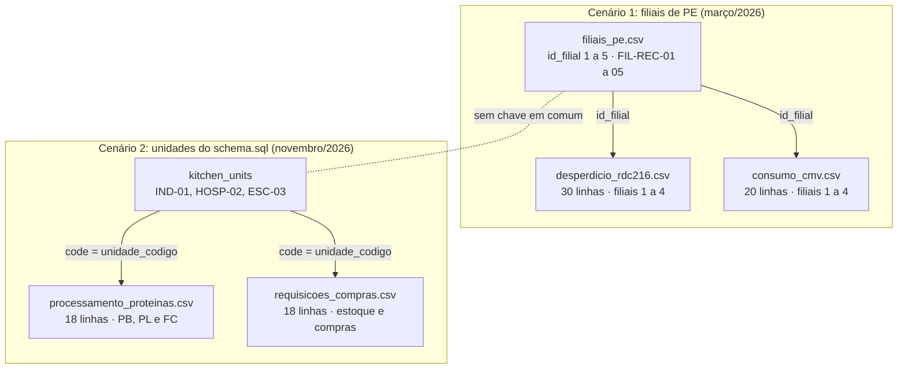
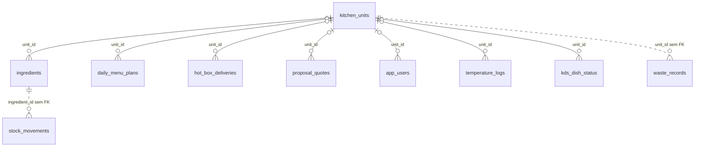

# EvoluiTI: Guia de Localização da Sprint 1 (Trilha de Dados)

> Atualizado em 25/11/2026 | Ponto de partida do Dicionário de Dados da Sprint 1 | Revisado com os 5 CSVs, o `schema.sql` e o `gastrocore_schema.json` enviados

## Sumário

- [Glossário em linguagem simples](#glossário-em-linguagem-simples)
- [Visão geral dos 18 conjuntos de dados](#visão-geral-dos-18-conjuntos-de-dados)
- [Como os dados se conectam](#como-os-dados-se-conectam)
- [Dicionário dos 5 CSVs](#dicionário-dos-5-csvs)
- [Dicionário das 13 tabelas do banco](#dicionário-das-13-tabelas-do-banco)
- [Primeiros sinais nos dados](#primeiros-sinais-nos-dados)
- [Checklist de limpeza](#checklist-de-limpeza)
- [Dúvidas para o tech lead](#dúvidas-para-o-tech-lead)
- [Próximos passos da Sprint 1](#próximos-passos-da-sprint-1)

## Glossário em linguagem simples

| Termo | O que é, em palavras simples | Onde aparece |
| --- | --- | --- |
| **UAN** | Unidade de Alimentação e Nutrição: cozinha que prepara refeições em grande quantidade (fábricas, hospitais, escolas). | Todo o projeto |
| **CMV** | Custo da Mercadoria Vendida: quanto se gastou em ingredientes para fazer as refeições. | `consumo_cmv.csv`, `meta_cmv_percentual` |
| **Orçado x realizado** | Orçado é o que se planejou gastar. Realizado é o que realmente foi gasto. A diferença é o desvio. | `consumo_cmv.csv` |
| **PAX** | Pessoas atendidas, ou seja, refeições servidas. | `refeicoes_produzidas_pax`, `average_pax_per_day` |
| **PB e PL** | Peso bruto (como a carne chega) e peso limpo (pronto para cozinhar). O PL nunca pode ser maior que o PB. | `processamento_proteinas.csv` |
| **FC (fator de correção)** | PB ÷ PL. Se o FC é 1,25, é preciso comprar 1,25 kg para aproveitar 1 kg. Nunca pode ser menor que 1. | `fator_correcao_real`, `fator_correcao_teorico` |
| **Apara, rejeito, exsudato** | Apara é o que se tira na limpeza (gordura, pele, pontas). Rejeito é o que não serve e vai fora. Exsudato é o líquido que sai da carne ao descongelar. | `apara_kg`, `rejeito_kg`, `peso_pos_descong_kg` |
| **Sobra limpa** | Comida pronta que não chegou a ser servida. | `tipo_descarte`, `waste_records` |
| **Resto-ingesta** | O que sobra nos pratos depois da refeição. | `resto_ingesta_por_pax_gramas` |
| **RDC 216** | Norma da Anvisa de boas práticas em serviços de alimentação. Define, por exemplo, as temperaturas seguras. | `desperdicio_rdc216.csv`, `temperature_logs` |
| **Hot Box** | Caixa térmica que leva comida quente de uma cozinha até o cliente. | `hot_box_deliveries` |
| **Kardex e PVPS** | Kardex é o histórico de entradas e saídas do estoque. PVPS significa "primeiro que vence, primeiro que sai". | `stock_movements`, `ingredients.batches` |
| **KDS** | Tela da cozinha que mostra cada prato como a iniciar, preparando ou pronto. | `kds_dish_status` |
| **Curva ABC** | Divide os itens pelo peso no custo total. A: poucos itens que concentram o gasto. B: intermediários. C: muitos itens de pouco peso. Meta de referência: 80/15/5. | `classificacao_abc` |
| **Z-Score** | Mede o quanto um valor se afasta do normal. Z maior que +2 é tratado como anomalia. | Sprint 3 |
| **Medallion (Bronze, Silver, Gold)** | Três camadas de dados. Bronze: como chegam. Silver: limpos e padronizados. Gold: prontos para o painel. | Toda a trilha |
| **Star Schema** | Modelo com fatos (os números, como CMV e desperdício) ligados a dimensões (quem, onde e quando: unidade, receita, tempo). | Sprint 2 |
| **RLS** | Regra de segurança do Supabase que define quem pode ler e gravar cada linha. | `schema.sql` |
| **Tenant e white-label** | Tenant é a empresa cliente que usa o sistema. White-label é usar o sistema com a marca dela. | `tenant_configs` |

## Visão geral dos 18 conjuntos de dados

| # | Fonte | Origem | Linhas x colunas | O que guarda | Liga com | No JSON (nome ou grupo) |
| --- | --- | --- | --- | --- | --- | --- |
| 1 | `gastrocore_filiais_pe.csv` | CSV | 5 x 11 | As 5 filiais de Pernambuco, com capacidade, meta de CMV e nutricionista responsável. | `id_filial` (desperdício e consumo) | `dim_filiais` |
| 2 | `gastrocore_desperdicio_rdc216.csv` | CSV | 30 x 13 | Pesagens de sobras, restos de prato e aparas em 4 filiais (01 a 04/03/2026). | `id_filial` com o cadastro de filiais | `fato_desperdicio_rdc216` |
| 3 | `gastrocore_consumo_cmv.csv` | CSV | 20 x 17 | Consumo previsto e real de insumos, com o desvio de custo, em 4 filiais (01 a 04/03/2026). | `id_filial` com o cadastro de filiais | `fato_consumo_cmv` |
| 4 | `gastrocore_processamento_proteinas.csv` | CSV | 18 x 15 | Rendimento de cada carne: peso comprado, descongelado e limpo (02 a 14/11/2026). | `unidade_codigo` = `kitchen_units.code` | não consta |
| 5 | `gastrocore_requisicoes_compras.csv` | CSV | 18 x 13 | Pedidos de estoque, transferências e solicitações de compra (02 a 13/11/2026). | `unidade_codigo` = `kitchen_units.code` | não consta |
| 6 | `kitchen_units` | `schema.sql` | 3 x 11 | Cadastro das unidades da rede | todas as outras tabelas, por `unit_id` | Core Multi-Unidades |
| 7 | `ingredients` | `schema.sql` | 0 x 19 | Estoque de insumos, com lote e validade | `kitchen_units` (`unit_id`) | Suprimentos & PVPS |
| 8 | `technical_sheets` | `schema.sql` | 0 x 18 | Receitas padronizadas com custo por porção | nenhuma chave estrangeira | Engenharia de Receitas |
| 9 | `daily_menu_plans` | `schema.sql` | 0 x 17 | Cardápio planejado por dia e refeição | `kitchen_units` (`unit_id`) | Planejamento de Cardápio |
| 10 | `waste_records` | `schema.sql` | 0 x 15 | Balança de sobras e desperdício (RDC 216) | `unit_id` sem chave estrangeira | Balança RDC 216 |
| 11 | `hot_box_deliveries` | `schema.sql` | 0 x 14 | Entregas em caixa térmica, com temperatura | `kitchen_units` (`unit_id`) | Logística Térmica |
| 12 | `proposal_quotes` | `schema.sql` | 0 x 16 | Orçamentos de eventos e contratos | `kitchen_units` (`unit_id`) | Comercial & Eventos |
| 13 | `tenant_configs` | `schema.sql` | 1 x 8 | Dados e módulos da empresa cliente | nenhuma chave estrangeira | Governança White-Label |
| 14 | `app_users` | `schema.sql` | 7 x 9 | Usuários e perfis de acesso | `kitchen_units` (`unit_id`) | RBAC & PIN Chão de Fábrica |
| 15 | `temperature_logs` | `schema.sql` | 0 x 9 | Medições de temperatura de equipamentos | `kitchen_units` (`unit_id`) | Termometria RDC 216 |
| 16 | `stock_movements` | `schema.sql` | 0 x 18 | Kardex: entradas e saídas do estoque | `ingredient_id` sem chave estrangeira | Kardex Auditável |
| 17 | `kds_dish_status` | `schema.sql` | 0 x 9 | Fila de pratos na tela da cozinha | `kitchen_units` (`unit_id`) | KDS Chão de Fábrica |
| 18 | `system_heartbeat` | `schema.sql` | 0 x 4 | Sinal de vida do banco (keep-alive) | nenhuma chave estrangeira | SRE Keep-Alive |

Nas tabelas do banco, o número de linhas é o do seed (a carga inicial de demonstração). Só `kitchen_units`, `tenant_configs` e `app_users` vêm com dados; as outras 10 têm 0 linhas.

## Como os dados se conectam

**Para juntar duas fontes, use esta chave**

| Para juntar... | Use... | Cuidado |
| --- | --- | --- |
| Desperdício ou consumo com as filiais | `id_filial` | Nunca junte pelo nome: `nome_filial` vem sem acento nos fatos ("Satelite") e com acento no cadastro ("Satélite") |
| Proteínas ou requisições com as unidades do banco | `unidade_codigo` = `kitchen_units.code` | Nas outras tabelas do banco, `unit_id` guarda o `id` da unidade (como `unit-industrial`), não o código `IND-01` |
| Qualquer tabela do banco com `unit_id` | `unit_id` = `kitchen_units.id` | Em `waste_records` não há chave estrangeira, então vale conferir se todo `unit_id` existe |
| Movimentos de estoque com os insumos | `stock_movements.ingredient_id` = `ingredients.id` | Também sem chave estrangeira |
| Filiais de PE com as unidades do banco | Não existe chave | São dois cadastros diferentes (dúvida 2) |
| CSV de desperdício com `waste_records` | Não existe chave | `id_filial` é número e `unit_id` é texto; o tipo de descarte precisa de de-para |

**Mapa 1: os dois cenários dos CSVs**

A filial 5 (Vitória) não aparece em nenhum CSV de fatos.

**Mapa 2: as 13 tabelas do banco**

Linhas cheias são chaves estrangeiras do banco. Linhas pontilhadas são ligações que existem na prática, mas sem chave estrangeira.

As tabelas `technical_sheets`, `tenant_configs` e `system_heartbeat` não têm ligação formal com as outras e por isso não aparecem no mapa.

## Dicionário dos 5 CSVs

Todos os CSVs usam vírgula como separador, ponto como decimal e datas no formato `AAAA-MM-DD`. A coluna **Exemplo ou valores** mostra um valor real do arquivo; nas colunas de categoria, mostra os valores que aparecem e quantas vezes.

### `gastrocore_filiais_pe.csv`: cadastro das filiais (5 linhas x 11 colunas)

Cadastro das unidades de produção de refeições no estado. Cada linha é uma filial.

- **Período:** sem datas (cadastro)
- **Nome no JSON:** `dim_filiais`
- **Liga com:** `id_filial` é a chave usada pelos CSVs de desperdício e de consumo
- **Uso na trilha:** Base da `dim_unidade` (camada Bronze).

| Coluna | Tipo | O que significa | Exemplo ou valores |
| --- | --- | --- | --- |
| `id_filial` | Inteiro | Número de identificação da filial. É usado nas outras tabelas para ligar os dados à filial. | `1` |
| `codigo_unidade` | Texto | Código curto da unidade (ex.: FIL-REC-01). | `FIL-REC-01` |
| `nome_unidade` | Texto | Nome completo da unidade. | `Cozinha Central Recife Antigo` |
| `regiao` | Texto | Região de Pernambuco onde a unidade fica. | `Metropolitana do Recife` |
| `cidade` | Texto | Cidade da unidade. | `Recife` |
| `uf` | Texto | Estado (sigla). | valores: `PE` (5) |
| `tipo_operacao` | Texto | Como a unidade trabalha: cozinha central, cozinha satélite, produção local ou refeitório. | `Cozinha Central (Produção & Distribuição)` |
| `capacidade_refeicoes_dia` | Inteiro | Quantidade máxima de refeições que a unidade consegue produzir por dia. | `4500` |
| `meta_cmv_percentual` | Número | Meta de CMV (custo da mercadoria vendida, ou seja, o custo dos ingredientes) em percentual para a unidade. | `32.5` |
| `responsavel_tecnica` | Texto | Nutricionista responsável pela unidade, com o número de registro no conselho (CRN-6). | `Dra. Mariana Albuquerque (CRN-6 4521)` |
| `status_operacional` | Texto | Situação da unidade (ex.: Ativa). | valores: `Ativa` (5) |

### `gastrocore_desperdicio_rdc216.csv`: desperdício e controle sanitário (30 linhas x 13 colunas)

Registra tudo o que foi descartado nas refeições (sobras, restos dos pratos e aparas), com o peso, o custo e a situação sanitária. A RDC 216 é a norma da Anvisa sobre boas práticas em serviços de alimentação.

- **Período:** 01 a 04/03/2026
- **Nome no JSON:** `fato_desperdicio_rdc216`
- **Liga com:** `id_filial` com o cadastro de filiais
- **Uso na trilha:** `fato_desperdicio`, KPI resto-ingesta, Pareto e Z-Score.

| Coluna | Tipo | O que significa | Exemplo ou valores |
| --- | --- | --- | --- |
| `id_registro` | Inteiro | Número de identificação do registro. | `1` |
| `data_registro` | Data | Dia em que o descarte foi registrado. | `2026-03-01` |
| `id_filial` | Inteiro | Número da filial (liga com a tabela de filiais). | `1` |
| `nome_filial` | Texto | Nome da filial. | `Cozinha Central Recife Antigo` |
| `turno` | Texto | Refeição em que o descarte aconteceu (Almoco, Jantar, Ceia). | valores: `Almoco` (26), `Jantar` (3), `Ceia` (1) |
| `tipo_descarte` | Texto | Tipo do descarte: Sobra Limpa (comida pronta que não foi servida), Resto Ingesta (sobra deixada nos pratos) ou Perda em Pre-Preparo (aparas e cascas). | valores: `Sobra Limpa (Nao Distribuida)` (15), `Resto Ingesta (Descarte Prato)` (13), `Perda em Pre-Preparo (Aparas)` (2) |
| `peso_kg` | Número | Peso do que foi descartado, em quilos. | `18.4` |
| `custo_estimado_reais` | Número | Custo estimado do que foi jogado fora, em reais. Fica 0 no resto de prato. Peso × preço por kg fixo: R$ 13,50 a 14,00 (sobra), R$ 5,50 (aparas) e 0,00 (resto de prato). | `248.40` |
| `refeicoes_produzidas_pax` | Inteiro | Quantidade de refeições produzidas no turno (pax significa pessoas atendidas). Repete o mesmo valor para todos os registros do mesmo turno. | `1850` |
| `resto_ingesta_por_pax_gramas` | Número | Média de sobra no prato por pessoa, em gramas (peso do resto dividido pelas refeições). Só é preenchido no resto de prato, nos demais fica 0. Cálculo: peso × 1000 ÷ refeições. Meta: até 35 g por refeição. | `28.16` |
| `temp_afericao_celsius` | Número | Temperatura medida do alimento, em graus Celsius. Fica 0 quando não se aplica (resto de prato). Alimento quente deve ficar a 60 °C ou mais. Temperatura da sobra. O 0,0 do resto de prato quer dizer "não aferido". | `68.5` |
| `status_sanitario` | Texto | Situação do descarte: Conforme RDC 216, Risco Termico (<60C), Apara Organica ou Descarte Obrigatorio. | valores: `Conforme RDC 216` (13), `Descarte Obrigatorio` (13), `Apara Organica` (2), `Risco Termico (<60C)` (2) |
| `motivo_declarado` | Texto | Explicação, em texto livre, de por que houve o descarte. | `Producao excedente de arroz com castanhas` |

### `gastrocore_consumo_cmv.csv`: consumo e CMV (20 linhas x 17 colunas)

Compara o consumo de ingredientes planejado com o que foi realmente usado, e mostra quanto isso custou a mais ou a menos que o orçado. Cada linha é um insumo, em uma filial, em um dia.

- **Período:** 01 a 04/03/2026
- **Nome no JSON:** `fato_consumo_cmv`
- **Liga com:** `id_filial` com o cadastro de filiais
- **Uso na trilha:** Fato de CMV, Curva ABC e fator de correção.

| Coluna | Tipo | O que significa | Exemplo ou valores |
| --- | --- | --- | --- |
| `id_consumo` | Inteiro | Número de identificação da linha. | `1` |
| `data_competencia` | Data | Dia a que o consumo se refere. | `2026-03-01` |
| `id_filial` | Inteiro | Número da filial (liga com a tabela de filiais). | `1` |
| `nome_filial` | Texto | Nome da filial. | `Cozinha Central Recife Antigo` |
| `categoria_insumo` | Texto | Grupo do ingrediente (ex.: Proteina Bovina, Hortifruti, Graos e Cereais). | valores: `Hortifruti` (6), `Proteina Bovina` (5), `Proteina Ave` (2), `Graos e Cereais` (2), `Proteina Suina` (2), `Proteina Caprina/Bovina` (1), `Proteina Peixe` (1), `Laticinios` (1) |
| `nome_insumo` | Texto | Nome do ingrediente. | `Acem Bovina em Cubos` |
| `qtd_prevista_kg` | Número | Quantidade planejada para uso, em quilos. | `340.0` |
| `qtd_real_kg` | Número | Quantidade realmente usada, em quilos. | `378.5` |
| `custo_unitario_kg` | Número | Preço de 1 quilo do ingrediente, em reais. | `34.50` |
| `cmv_orcado_reais` | Número | Custo que deveria ter sido gasto (quantidade prevista vezes custo por quilo), em reais. Cálculo: quantidade prevista × custo por kg. | `11730.00` |
| `cmv_realizado_reais` | Número | Custo que realmente foi gasto (quantidade real vezes custo por quilo), em reais. Cálculo: quantidade real × custo por kg. | `13058.25` |
| `desvio_cmv_reais` | Número | Diferença entre o gasto real e o orçado, em reais. Positivo significa que gastou mais que o planejado. Cálculo: realizado menos orçado. Positivo = gastou mais que o previsto. | `1328.25` |
| `desvio_cmv_percentual` | Número | Mesma diferença, em percentual sobre o valor orçado. Cálculo: desvio ÷ orçado × 100. | `11.32` |
| `classificacao_abc` | Texto | Importância do ingrediente no custo total: Curva A (pesa mais), B (intermediário) ou C (pesa menos). | valores: `Curva A` (12), `Curva B` (5), `Curva C` (3) |
| `fator_correcao_teorico` | Número | Fator de correção esperado, previsto na ficha técnica da receita. Indica quanto do produto bruto se perde na limpeza e preparo. | `1.25` |
| `fator_correcao_real` | Número | Fator de correção que realmente ocorreu. Se for maior que o teórico, houve mais perda que o esperado. Aproximadamente: fator teórico × quantidade real ÷ quantidade prevista. | `1.39` |
| `motivo_desvio` | Texto | Explicação, em texto livre, do motivo da diferença de consumo ou custo. | `Lote com teor de gordura e aponeurose superior a ficha` |

### `gastrocore_processamento_proteinas.csv`: rendimento de proteínas (18 linhas x 15 colunas)

Acompanha o que acontece com cada carne ao ser preparada: ela é descongelada, aparada e limpa, e parte do peso original se perde pelo caminho. A tabela mostra quanto se perdeu e se isso passou do limite aceitável.

- **Período:** 02 a 14/11/2026
- **Nome no JSON:** não consta no `gastrocore_schema.json`
- **Liga com:** `unidade_codigo` é o mesmo valor de `kitchen_units.code`
- **Uso na trilha:** Validação PB ≥ PL e FC ≥ 1 (Sprint 1).

| Coluna | Tipo | O que significa | Exemplo ou valores |
| --- | --- | --- | --- |
| `data_processamento` | Data | Dia em que a proteína foi preparada. | `2026-11-02` |
| `unidade_codigo` | Texto | Código da unidade que fez o preparo. | valores: `IND-01` (9), `HOSP-02` (5), `ESC-03` (4) |
| `turno` | Texto | Refeição para a qual a proteína foi preparada (almoco, jantar, ceia). | valores: `almoco` (15), `ceia` (2), `jantar` (1) |
| `tipo_proteina` | Texto | Grupo da proteína: AVES, BOVINA, SUINA, PESCADOS, EMBUTIDOS ou MIUDOS. | valores: `BOVINA` (7), `AVES` (5), `SUINA` (2), `EMBUTIDOS` (2), `PESCADOS` (1), `MIUDOS` (1) |
| `nome_proteina` | Texto | Nome do corte ou produto (ex.: Filé de Frango Congelado). | `File de Frango Congelado` |
| `peso_bruto_kg` | Número | Peso inicial, como o produto chegou, em quilos. Também chamado de PB: o peso de compra. | `40.00` |
| `peso_pos_descong_kg` | Número | Peso depois do descongelamento. Cortes resfriados (não congelados) mantêm o mesmo peso bruto. | `36.80` |
| `apara_kg` | Número | Peso retirado na limpeza que sai como aparas (gordura, pele, pontas), em quilos. | `3.20` |
| `rejeito_kg` | Número | Peso descartado por não servir para uso (ex.: osso, nervo, parte estragada), em quilos. | `1.60` |
| `peso_limpo_kg` | Número | Peso final aproveitável, pronto para cozinhar, em quilos. Também chamado de PL. Cálculo: peso pós-descongelamento menos apara menos rejeito. | `32.00` |
| `perda_total_kg` | Número | Total perdido no processo (peso bruto menos peso limpo), em quilos. Cálculo: PB menos PL. | `8.00` |
| `perda_pct` | Número | Perda em percentual do peso bruto. Quanto maior, pior o aproveitamento. Cálculo: perda total ÷ PB × 100. | `20.00` |
| `fator_correcao_real` | Número | Quantas vezes o peso bruto é maior que o peso limpo (bruto dividido por limpo). Ex.: 1,25 significa que são necessários 1,25 kg comprados para cada 1 kg aproveitado. Também chamado de FC. Cálculo: PB ÷ PL. Nunca pode ser menor que 1. | `1.25` |
| `limite_perda_pct` | Número | Perda máxima aceitável em percentual para aquele tipo de produto. | `25.00` |
| `status_perda` | Texto | Resultado da conferência: DENTRO_DA_META, ACIMA_DO_LIMITE ou CRITICO_DESCONGELAMENTO (perda muito acima do limite; a regra exata não está documentada). Regra observada: perda menor ou igual ao limite = `DENTRO_DA_META`. A regra do `CRITICO_DESCONGELAMENTO` não está documentada. | valores: `DENTRO_DA_META` (10), `ACIMA_DO_LIMITE` (7), `CRITICO_DESCONGELAMENTO` (1) |

### `gastrocore_requisicoes_compras.csv`: requisições e compras (18 linhas x 13 colunas)

Registra pedidos feitos pelas unidades: retirada de itens do estoque, transferência entre unidades e pedidos de compra. Cada linha é um item de um pedido.

- **Período:** 02 a 13/11/2026
- **Nome no JSON:** não consta no `gastrocore_schema.json`
- **Liga com:** `unidade_codigo` é o mesmo valor de `kitchen_units.code`
- **Uso na trilha:** Rupturas de estoque e consumo Kardex.

| Coluna | Tipo | O que significa | Exemplo ou valores |
| --- | --- | --- | --- |
| `tipo_movimento` | Texto | Tipo do pedido: requisicao_estoque (retirada do estoque), transferencia_unidade (item vindo de outra unidade) ou solicitacao_compra (pedido de compra ao fornecedor). | valores: `requisicao_estoque` (8), `solicitacao_compra` (7), `transferencia_unidade` (3) |
| `data_solicitacao` | Data | Dia em que o pedido foi feito. | `2026-11-02` |
| `unidade_codigo` | Texto | Código da unidade que fez o pedido (ex.: IND-01, HOSP-02, ESC-03). | valores: `IND-01` (9), `HOSP-02` (5), `ESC-03` (4) |
| `turno` | Texto | Refeição para a qual o item é necessário (almoco, ceia) ou geral, quando o pedido não é de um turno específico. `geral` é usado nas solicitações de compra e não é um turno de produção. | valores: `almoco` (9), `geral` (7), `ceia` (2) |
| `categoria_item` | Texto | Grupo do item, como SECOS (arroz, açúcar, temperos) ou PROTEINAS (carnes e frango). | valores: `SECOS` (11), `PROTEINAS` (7) |
| `nome_item` | Texto | Nome do produto pedido. | `Acucar Cristal 1kg` |
| `unidade_medida` | Texto | Medida usada nas quantidades: KG (quilo), UNI/UND (unidade) ou GL (galão). | valores: `KG` (14), `UNI` (2), `UND` (1), `GL` (1) |
| `saldo_estoque` | Número | Quantidade que a unidade tinha em estoque na hora do pedido. | `85.0` |
| `qtd_solicitada` | Número | Quantidade pedida. | `60.0` |
| `qtd_entregue` | Número | Quantidade que realmente foi entregue. | `60.0` |
| `qtd_pendente` | Número | Quantidade que ainda falta entregar (pedida menos entregue). Cálculo: solicitada menos entregue. | `10.0` |
| `valor_unit_estimado` | Número | Preço estimado de uma unidade de medida do item, em reais. | `4.45` |
| `valor_total_estimado` | Número | Valor estimado do pedido (quantidade solicitada vezes o preço unitário), em reais. Cálculo: quantidade solicitada × preço unitário (não usa a quantidade entregue). | `267.00` |

## Dicionário das 13 tabelas do banco

Banco PostgreSQL (Supabase) do GastroCore ERP v0.3.0. Os nomes das tabelas e das colunas estão em inglês, como no banco. Todas as chaves primárias são `TEXT`, e as datas operacionais (`date_str`, `timestamp`, `expiration_date`, entre outras) também estão em `TEXT`, não em tipo data.

**Tipos usados neste guia:** Texto = `TEXT`, Número = `NUMERIC`, Inteiro = `INTEGER`, Verdadeiro/falso = `BOOLEAN`, Data e hora = `TIMESTAMPTZ`, Lista de textos = `TEXT[]`, Dados estruturados = `JSONB`.

O `gastrocore_schema.json` lista só as colunas-chave de cada tabela. Todas elas existem no `schema.sql`, com os mesmos valores permitidos e as mesmas chaves estrangeiras. Este dicionário traz as colunas completas.

> O PDF do dicionário original saiu cortado na coluna "Uso analítico". Os textos de uso abaixo foram completados pelo sentido e vale confirmar no HTML original.

### `kitchen_units`: unidades operacionais

Cadastro das unidades (filiais) da rede. As outras tabelas se ligam a ela pela coluna id.

- **Grupo (no JSON):** Core Multi-Unidades
- **Uso analítico (Medallion):** Origina a `dim_unidade` (receita potencial e metas de refeições por dia).
- **Seed:** 3 linhas (IND-01, HOSP-02, ESC-03)
- **Liga com:** todas as outras tabelas, por `unit_id`

| Coluna | Tipo | O que significa | Regras |
| --- | --- | --- | --- |
| `id` | Texto | Identificador único da unidade. | chave primária |
| `name` | Texto | Nome completo da unidade. | obrigatório |
| `code` | Texto | Código curto da unidade (ex.: IND-01, HOSP-02, ESC-03). É o mesmo código usado como unidade_codigo nos arquivos CSV de requisições e de proteínas. | obrigatório |
| `type` | Texto | Tipo da unidade: industrial, hospitalar ou escolar. | obrigatório; valores: `industrial`, `hospitalar`, `escolar` |
| `address` | Texto | Endereço da unidade. | obrigatório |
| `manager_name` | Texto | Nome do gerente ou responsável. | obrigatório |
| `contact_email` | Texto | E-mail de contato da unidade. | obrigatório |
| `average_pax_per_day` | Número | Média de refeições servidas por dia (pax significa pessoas atendidas). | obrigatório; padrão: `0` |
| `contract_price_per_pax` | Número | Valor do contrato por refeição servida, em reais. | obrigatório; padrão: `0` |
| `status` | Texto | Situação da unidade: ativa, manutencao ou inativa. | obrigatório; valores: `ativa`, `manutencao`, `inativa`; padrão: `ativa` |
| `created_at` | Data e hora | Data e hora em que o cadastro foi criado. | padrão: data e hora atuais |

**Linhas do seed**

| `id` | `code` | `type` | `average_pax_per_day` | `contract_price_per_pax` |
| --- | --- | --- | --- | --- |
| `unit-industrial` | `IND-01` | `industrial` | 550 | R$ 14,50 |
| `unit-hospitalar` | `HOSP-02` | `hospitalar` | 320 | R$ 18,90 |
| `unit-escolar` | `ESC-03` | `escolar` | 420 | R$ 12,80 |

Só estas 3 unidades têm preço por refeição. As 5 filiais de PE não têm.

### `ingredients`: insumos e estoque

Itens do almoxarifado e da cozinha: alimentos, descartáveis, produtos de higiene, utensílios e equipamentos, com estoque, custo e validade.

- **Grupo (no JSON):** Suprimentos & PVPS
- **Uso analítico (Medallion):** Rupturas, lotes vencidos e Curva ABC de insumos.
- **Seed:** vazia
- **Liga com:** `kitchen_units` (`unit_id`)

| Coluna | Tipo | O que significa | Regras |
| --- | --- | --- | --- |
| `id` | Texto | Identificador único do item. | chave primária |
| `unit_id` | Texto | Unidade (de kitchen_units) onde o item está guardado. | pode ficar vazio; liga com `kitchen_units.id` |
| `name` | Texto | Nome do item. | obrigatório |
| `item_type` | Texto | Tipo do item: alimento, descartavel, higiene, utensilio ou equipamento. | valores: `alimento`, `descartavel`, `higiene`, `utensilio`, `equipamento`; padrão: `alimento` |
| `category` | Texto | Grupo do item (ex.: proteínas, secos, hortifruti). | obrigatório |
| `unit` | Texto | Medida usada no estoque: kg, g, l, L, ml, un, cx, pct ou rolo. | obrigatório; valores: `kg`, `g`, `l`, `L`, `ml`, `un`, `cx`, `pct`, `rolo` |
| `current_stock` | Número | Quantidade atual em estoque. | obrigatório; padrão: `0` |
| `min_stock` | Número | Estoque mínimo desejado. Abaixo disso, o item precisa ser reposto. | obrigatório; padrão: `0` |
| `unit_cost` | Número | Custo de uma unidade de medida do item, em reais. | obrigatório; padrão: `0` |
| `supplier` | Texto | Nome do fornecedor. | obrigatório |
| `brand` | Texto | Marca do produto. | pode ficar vazio |
| `barcode` | Texto | Código de barras. | pode ficar vazio |
| `lot_number` | Texto | Número do lote do produto. | pode ficar vazio |
| `expiration_date` | Texto | Data de validade, guardada como texto. | pode ficar vazio |
| `status` | Texto | Situação do item: normal, baixo (pouco estoque), vencendo ou vencido. | valores: `normal`, `baixo`, `vencendo`, `vencido`; padrão: `normal` |
| `allergens` | Lista de textos | Lista de alérgenos presentes no item (ex.: glúten, leite). | padrão: vazio |
| `location` | Texto | Lugar onde o item fica guardado (prateleira, câmara fria etc.). | pode ficar vazio |
| `batches` | Dados estruturados | Lista dos lotes do item, cada um com seus dados (usada no controle PVPS, que é primeiro a vencer, primeiro a sair). | padrão: vazio |
| `updated_at` | Data e hora | Data e hora da última atualização. | padrão: data e hora atuais |

### `technical_sheets`: fichas técnicas

Receitas padronizadas, com ingredientes, rendimento, custo e preço sugerido.

- **Grupo (no JSON):** Engenharia de Receitas
- **Uso analítico (Medallion):** Origina a `dim_receita`. O fator de correção sai de PB ÷ PL.
- **Seed:** vazia
- **Liga com:** nenhuma chave estrangeira

| Coluna | Tipo | O que significa | Regras |
| --- | --- | --- | --- |
| `id` | Texto | Identificador único da ficha. | chave primária |
| `title` | Texto | Nome da receita. | obrigatório |
| `category` | Texto | Tipo do prato: principal, guarnicao, salada, sobremesa, bebida, molho ou lanche. | obrigatório; valores: `principal`, `guarnicao`, `salada`, `sobremesa`, `bebida`, `molho`, `lanche` |
| `target_audience` | Lista de textos | Públicos para os quais a receita serve (ex.: industrial, hospitalar, escolar). | padrão: vazio |
| `dietary_tags` | Lista de textos | Etiquetas de dieta da receita (ex.: vegetariano, sem glúten). | padrão: vazio |
| `yield_portions` | Número | Quantidade de porções que a receita rende. | obrigatório; padrão: `1` |
| `portion_size_grams` | Número | Tamanho de cada porção, em gramas. | obrigatório; padrão: `100` |
| `preparation_time_min` | Inteiro | Tempo de preparo, em minutos. | obrigatório; padrão: `30` |
| `preparation_method` | Texto | Modo de preparo, em texto. | pode ficar vazio |
| `cooking_factor` | Número | Fator de cocção: relação entre o peso do alimento cru e o peso depois de cozido. | obrigatório; padrão: `1.0` |
| `ingredients` | Dados estruturados | Lista de ingredientes da receita com as quantidades. | obrigatório; padrão: vazio |
| `total_cost` | Número | Custo total da receita, em reais. | obrigatório; padrão: `0` |
| `cost_per_portion` | Número | Custo de cada porção, em reais. | obrigatório; padrão: `0` |
| `suggested_selling_price` | Número | Preço de venda sugerido por porção, em reais. | obrigatório; padrão: `0` |
| `margin_percent` | Número | Margem de lucro desejada, em percentual. | obrigatório; padrão: `40` |
| `allergens_summary` | Lista de textos | Resumo dos alérgenos da receita. | padrão: vazio |
| `allergens` | Lista de textos | Lista de alérgenos da receita. | padrão: vazio |
| `created_at` | Data e hora | Data e hora em que a ficha foi criada. | padrão: data e hora atuais |

### `daily_menu_plans`: planejamento de cardápio

Cardápio planejado por dia, unidade e refeição. As colunas terminadas em _ids guardam os códigos das fichas técnicas escolhidas.

- **Grupo (no JSON):** Planejamento de Cardápio
- **Uso analítico (Medallion):** Origina o `fato_cardapio` e a view de CMV planejado × realizado.
- **Seed:** vazia
- **Liga com:** `kitchen_units` (`unit_id`)

| Coluna | Tipo | O que significa | Regras |
| --- | --- | --- | --- |
| `id` | Texto | Identificador único do planejamento. | chave primária |
| `unit_id` | Texto | Unidade (de kitchen_units) para a qual o cardápio foi planejado. | pode ficar vazio; liga com `kitchen_units.id` |
| `date_str` | Texto | Data do cardápio, guardada como texto. | obrigatório |
| `day_of_week` | Texto | Dia da semana. | obrigatório |
| `shift` | Texto | Refeição do planejamento (padrão: Almoço). | obrigatório; padrão: `Almoço` |
| `planned_pax` | Número | Quantidade de refeições planejadas. | obrigatório; padrão: `100` |
| `price_per_pax_contracted` | Número | Valor contratado por refeição, em reais. | obrigatório; padrão: `0` |
| `principais_ids` | Lista de textos | Códigos das fichas técnicas dos pratos principais. | padrão: vazio |
| `guarnicoes_ids` | Lista de textos | Códigos das fichas técnicas das guarnições. | padrão: vazio |
| `bases_ids` | Lista de textos | Códigos das fichas técnicas das bases (ex.: arroz e feijão). | padrão: vazio |
| `saladas_ids` | Lista de textos | Códigos das fichas técnicas das saladas. | padrão: vazio |
| `molhos_ids` | Lista de textos | Códigos das fichas técnicas dos molhos. | padrão: vazio |
| `sobremesas_ids` | Lista de textos | Códigos das fichas técnicas das sobremesas. | padrão: vazio |
| `bebidas_ids` | Lista de textos | Códigos das fichas técnicas das bebidas. | padrão: vazio |
| `dietas_ids` | Lista de textos | Códigos das fichas técnicas das dietas especiais. | padrão: vazio |
| `notes` | Texto | Observações sobre o cardápio. | pode ficar vazio |
| `updated_at` | Data e hora | Data e hora da última atualização. | padrão: data e hora atuais |

### `waste_records`: balança de sobras e desperdício

Pesagem de tudo o que é descartado, conforme a norma RDC 216 da Anvisa.

- **Grupo (no JSON):** Balança RDC 216
- **Uso analítico (Medallion):** Alimenta o `fato_desperdicio`, o Pareto e o Z-Score.
- **Seed:** vazia
- **Liga com:** `unit_id` sem chave estrangeira

| Coluna | Tipo | O que significa | Regras |
| --- | --- | --- | --- |
| `id` | Texto | Identificador único do registro. | chave primária |
| `unit_id` | Texto | Código da unidade onde houve o descarte. | obrigatório; sem chave estrangeira: nada impede um valor que não existe na outra tabela |
| `timestamp` | Texto | Data e hora do registro, guardadas como texto. | obrigatório |
| `period` | Texto | Período ou refeição do descarte. | obrigatório |
| `operation_type` | Texto | Tipo de operação da unidade (ex.: industrial, hospitalar). | obrigatório |
| `unit_name` | Texto | Nome da unidade. | obrigatório |
| `category` | Texto | Tipo do descarte: pre_preparo (aparas), sobra_limpa (comida pronta não servida) ou resto_ingesto (sobra deixada no prato). | obrigatório; valores: `pre_preparo`, `sobra_limpa`, `resto_ingesto` |
| `item_or_recipe_name` | Texto | Nome do item ou da receita descartada. | obrigatório |
| `weight_kg` | Número | Peso descartado, em quilos. | obrigatório |
| `estimated_cost_per_kg` | Número | Custo estimado por quilo, em reais. | obrigatório |
| `total_loss_brl` | Número | Prejuízo total do descarte, em reais. | obrigatório |
| `reason` | Texto | Motivo do descarte. | obrigatório |
| `reported_by` | Texto | Nome de quem registrou. | obrigatório |
| `action_taken` | Texto | Ação tomada depois do descarte. | pode ficar vazio |
| `created_at` | Data e hora | Data e hora em que o registro foi criado no sistema. | padrão: data e hora atuais |

### `hot_box_deliveries`: entregas em hot box

Controle das entregas de refeições prontas em caixas térmicas, que devem chegar acima de 60 °C.

- **Grupo (no JSON):** Logística Térmica
- **Uso analítico (Medallion):** Conformidade térmica das rotas transportadas.
- **Seed:** vazia
- **Liga com:** `kitchen_units` (`unit_id`)

| Coluna | Tipo | O que significa | Regras |
| --- | --- | --- | --- |
| `id` | Texto | Identificador único da entrega. | chave primária |
| `unit_id` | Texto | Unidade (de kitchen_units) que produziu a refeição. | pode ficar vazio; liga com `kitchen_units.id` |
| `client_name` | Texto | Nome do cliente que recebe a entrega. | obrigatório |
| `vehicle_plate` | Texto | Placa do veículo. | obrigatório |
| `driver_name` | Texto | Nome do motorista. | obrigatório |
| `departure_time` | Texto | Horário de saída. | obrigatório |
| `arrival_time_estimated` | Texto | Horário previsto de chegada. | obrigatório |
| `dispatch_temp_celsius` | Número | Temperatura da comida na saída, em graus Celsius. | obrigatório |
| `arrival_temp_celsius` | Número | Temperatura da comida na chegada, em graus Celsius. Fica vazia até a entrega. | pode ficar vazio |
| `status` | Texto | Situação da entrega: em_preparo, em_transito, entregue ou nao_conforme (temperatura fora do limite). | obrigatório; valores: `em_preparo`, `em_transito`, `entregue`, `nao_conforme`; padrão: `em_preparo` |
| `boxes_count` | Número | Quantidade de caixas térmicas. | obrigatório; padrão: `1` |
| `seal_number` | Texto | Número do lacre das caixas. | obrigatório |
| `pax_count` | Número | Quantidade de refeições enviadas. | obrigatório; padrão: `1` |
| `updated_at` | Data e hora | Data e hora da última atualização. | padrão: data e hora atuais |

### `proposal_quotes`: orçamentos e eventos

Orçamentos para eventos, como coffee breaks, almoços corporativos, coquetéis e contratos mensais.

- **Grupo (no JSON):** Comercial & Eventos
- **Uso analítico (Medallion):** Análise comercial e margem por tipo de evento.
- **Seed:** vazia
- **Liga com:** `kitchen_units` (`unit_id`)

| Coluna | Tipo | O que significa | Regras |
| --- | --- | --- | --- |
| `id` | Texto | Identificador único do orçamento. | chave primária |
| `unit_id` | Texto | Unidade (de kitchen_units) responsável pelo evento. | pode ficar vazio; liga com `kitchen_units.id` |
| `client_name` | Texto | Nome do cliente. | obrigatório |
| `event_type` | Texto | Tipo do evento: coffee_break, almoco_corporativo, coquetel ou contrato_mensal. | obrigatório; valores: `coffee_break`, `almoco_corporativo`, `coquetel`, `contrato_mensal` |
| `event_date` | Texto | Data do evento, guardada como texto. | obrigatório |
| `pax` | Número | Quantidade de pessoas atendidas. | obrigatório; padrão: `50` |
| `raw_food_cost` | Número | Custo dos alimentos, em reais. | obrigatório; padrão: `0` |
| `disposables_cost` | Número | Custo dos descartáveis, em reais. | obrigatório; padrão: `0` |
| `staff_cost` | Número | Custo da equipe, em reais. | obrigatório; padrão: `0` |
| `logistics_cost` | Número | Custo de transporte e logística, em reais. | obrigatório; padrão: `0` |
| `target_margin_percent` | Número | Margem de lucro desejada, em percentual. | obrigatório; padrão: `40` |
| `final_price_per_pax` | Número | Preço final cobrado por pessoa, em reais. | obrigatório; padrão: `0` |
| `total_proposal_value` | Número | Valor total do orçamento, em reais. | obrigatório; padrão: `0` |
| `status` | Texto | Situação do orçamento: rascunho, enviada, aprovada ou recusada. | obrigatório; valores: `rascunho`, `enviada`, `aprovada`, `recusada`; padrão: `rascunho` |
| `items_included` | Lista de textos | Lista dos itens incluídos no orçamento. | padrão: vazio |
| `created_at` | Data e hora | Data e hora em que o orçamento foi criado. | padrão: data e hora atuais |

### `tenant_configs`: configuração da empresa

Dados da empresa dona do sistema e configuração de aparência e módulos (modelo white-label, em que a empresa usa sua própria marca).

- **Grupo (no JSON):** Governança White-Label
- **Uso analítico (Medallion):** Metadados do white-label (Bondegusto).
- **Seed:** 1 linha
- **Liga com:** nenhuma chave estrangeira

| Coluna | Tipo | O que significa | Regras |
| --- | --- | --- | --- |
| `id` | Texto | Identificador da configuração (padrão: default_tenant). | chave primária; padrão: `default_tenant` |
| `company_name` | Texto | Razão social da empresa. | obrigatório |
| `trading_name` | Texto | Nome fantasia da empresa. | obrigatório |
| `cnpj` | Texto | CNPJ da empresa. | obrigatório |
| `primary_color` | Texto | Cor principal da marca, em código hexadecimal (padrão: #059669). | obrigatório; padrão: `#059669` |
| `active_plan` | Texto | Plano contratado (padrão: pro). | obrigatório; padrão: `pro` |
| `enabled_modules` | Dados estruturados | Quais módulos do sistema estão ligados (ex.: fichas técnicas, estoque, hot box), cada um como verdadeiro ou falso. | pode ficar vazio |
| `updated_at` | Data e hora | Data e hora da última atualização. | padrão: data e hora atuais |

### `app_users`: usuários e perfis de acesso

Pessoas que usam o sistema, com o perfil que define o que cada uma pode fazer.

- **Grupo (no JSON):** RBAC & PIN Chão de Fábrica
- **Uso analítico (Medallion):** Auditoria por operador responsável pelos lançamentos. Nunca levar `password_hash` nem `pin` para o BI.
- **Seed:** 7 linhas
- **Liga com:** `kitchen_units` (`unit_id`)

| Coluna | Tipo | O que significa | Regras |
| --- | --- | --- | --- |
| `id` | Texto | Identificador único do usuário. | chave primária |
| `email` | Texto | E-mail do usuário. Não pode se repetir. | obrigatório; não se repete |
| `full_name` | Texto | Nome completo e cargo. | obrigatório |
| `role` | Texto | Perfil de acesso: admin, gerente, nutricionista, cozinheiro, estoquista, financeiro ou atendente. | obrigatório; valores: `admin`, `gerente`, `nutricionista`, `cozinheiro`, `estoquista`, `financeiro`, `atendente` |
| `unit_id` | Texto | Unidade (de kitchen_units) onde o usuário trabalha. Fica vazia para quem atua em toda a rede. | pode ficar vazio; liga com `kitchen_units.id` |
| `pin` | Texto | PIN de 4 dígitos usado no KDS (chão de fábrica). | pode ficar vazio |
| `password_hash` | Texto | Senha de acesso do usuário. Nos dados de demonstração está escrita em texto simples, sem proteção. | pode ficar vazio |
| `created_at` | Data e hora | Data e hora em que o usuário foi criado. | padrão: data e hora atuais |
| `updated_at` | Data e hora | Data e hora da última atualização. | padrão: data e hora atuais |

**Perfis do seed (7 usuários)**

| `role` | Unidade |
| --- | --- |
| `admin` | toda a rede |
| `gerente` | IND-01 |
| `nutricionista` | HOSP-02 |
| `cozinheiro` | IND-01 |
| `estoquista` | IND-01 |
| `financeiro` | toda a rede |
| `atendente` | ESC-03 |

### `temperature_logs`: registro de temperaturas

Medições de temperatura de equipamentos quentes e frios, exigidas pela RDC 216.

- **Grupo (no JSON):** Termometria RDC 216
- **Uso analítico (Medallion):** Alimenta o `fato_termometria` e a view de conformidade térmica.
- **Seed:** vazia
- **Liga com:** `kitchen_units` (`unit_id`)

| Coluna | Tipo | O que significa | Regras |
| --- | --- | --- | --- |
| `id` | Texto | Identificador único da medição. | chave primária |
| `unit_id` | Texto | Unidade (de kitchen_units) onde a medição foi feita. | pode ficar vazio; liga com `kitchen_units.id` |
| `equipment` | Texto | Nome do equipamento medido (ex.: balcão térmico, câmara fria). | obrigatório |
| `equipment_type` | Texto | Tipo do equipamento: quente ou frio. | valores: `quente`, `frio`; padrão: `quente` |
| `temperature` | Número | Temperatura medida, em graus Celsius. | obrigatório |
| `is_compliant` | Verdadeiro/falso | Se a temperatura está dentro do limite da norma (verdadeiro) ou fora (falso). | obrigatório |
| `time_str` | Texto | Horário da medição, guardado como texto. | obrigatório |
| `shift` | Texto | Turno ou refeição da medição. | obrigatório |
| `recorded_at` | Data e hora | Data e hora em que a medição foi registrada no sistema. | padrão: data e hora atuais |

### `stock_movements`: kardex, movimentações de estoque

Histórico de tudo o que entra e sai do estoque, para rastrear cada lote.

- **Grupo (no JSON):** Kardex Auditável
- **Uso analítico (Medallion):** Consumo real diário e Curva ABC.
- **Seed:** vazia
- **Liga com:** `ingredient_id` sem chave estrangeira

| Coluna | Tipo | O que significa | Regras |
| --- | --- | --- | --- |
| `id` | Texto | Identificador único da movimentação. | chave primária |
| `ingredient_id` | Texto | Código do item movimentado (de ingredients). | obrigatório; sem chave estrangeira: nada impede um valor que não existe na outra tabela |
| `ingredient_name` | Texto | Nome do item movimentado. | obrigatório |
| `batch_id` | Texto | Código do lote movimentado. | pode ficar vazio |
| `lot_number` | Texto | Número do lote. | pode ficar vazio |
| `brand` | Texto | Marca do produto. | pode ficar vazio |
| `type` | Texto | Tipo da movimentação: entrada, saida, perda ou ajuste. | obrigatório; valores: `entrada`, `saida`, `perda`, `ajuste` |
| `quantity` | Número | Quantidade movimentada. | obrigatório |
| `unit` | Texto | Medida da quantidade (kg, un, etc.). | obrigatório |
| `unit_cost` | Número | Custo de uma unidade de medida, em reais. | pode ficar vazio |
| `total_cost` | Número | Custo total da movimentação, em reais. | pode ficar vazio |
| `previous_stock` | Número | Estoque antes da movimentação. | obrigatório |
| `new_stock` | Número | Estoque depois da movimentação. | obrigatório |
| `reason` | Texto | Motivo da movimentação. | obrigatório |
| `document_number` | Texto | Número do documento relacionado (ex.: nota fiscal). | pode ficar vazio |
| `timestamp` | Texto | Data e hora da movimentação, guardadas como texto. | obrigatório |
| `user_name` | Texto | Nome de quem fez a movimentação. | obrigatório |
| `created_at` | Data e hora | Data e hora em que o registro foi criado no sistema. | padrão: data e hora atuais |

### `kds_dish_status`: fila de produção na cozinha

Acompanha em que etapa está o preparo de cada prato na tela da cozinha (KDS, sigla em inglês para sistema de exibição da cozinha).

- **Grupo (no JSON):** KDS Chão de Fábrica
- **Uso analítico (Medallion):** Tempo de preparo (`completed_at` menos `started_at`).
- **Seed:** vazia
- **Liga com:** `kitchen_units` (`unit_id`)

| Coluna | Tipo | O que significa | Regras |
| --- | --- | --- | --- |
| `id` | Texto | Identificador único do registro. | chave primária |
| `unit_id` | Texto | Unidade (de kitchen_units) que está produzindo. Se a unidade for apagada, o registro também é. | pode ficar vazio; liga com `kitchen_units.id` (se a unidade for apagada, este registro também é) |
| `date_str` | Texto | Data da produção, guardada como texto. | obrigatório |
| `shift` | Texto | Refeição da produção. | obrigatório |
| `recipe_id` | Texto | Código da receita (ficha técnica) em preparo. | obrigatório |
| `status` | Texto | Etapa do prato: a_iniciar, preparando ou pronto. | obrigatório; valores: `a_iniciar`, `preparando`, `pronto`; padrão: `a_iniciar` |
| `started_at` | Data e hora | Data e hora em que o preparo começou. | pode ficar vazio |
| `completed_at` | Data e hora | Data e hora em que o prato ficou pronto. | pode ficar vazio |
| `updated_at` | Data e hora | Data e hora da última atualização. | padrão: data e hora atuais |

### `system_heartbeat`: sinal de atividade do sistema

Tabela técnica. Um robô registra aqui um sinal de vida de tempos em tempos para o banco gratuito do Supabase não ser pausado por falta de uso.

- **Grupo (no JSON):** SRE Keep-Alive
- **Uso analítico (Medallion):** Disponibilidade do banco.
- **Seed:** vazia
- **Liga com:** nenhuma chave estrangeira

| Coluna | Tipo | O que significa | Regras |
| --- | --- | --- | --- |
| `id` | Texto | Identificador único do registro. | chave primária |
| `environment` | Texto | Ambiente que enviou o sinal (ex.: produção ou teste). | obrigatório |
| `last_ping_at` | Data e hora | Data e hora do último sinal recebido. | obrigatório; padrão: data e hora atuais |
| `source` | Texto | Quem enviou o sinal (padrão: github-actions). | obrigatório; padrão: `github-actions` |

## Primeiros sinais nos dados

Só leitura dos dados, sem interpretação. Servem de ponto de partida para o validador e para a Sprint 3.

- **Proteínas:** 8 dos 18 preparos passaram do limite de perda (7 como `ACIMA_DO_LIMITE` e 1 como `CRITICO_DESCONGELAMENTO`). O mais distante do limite é o Filé de Frango Congelado em ESC-03 (05/11): perda de 35% contra limite de 25%.
- **Resto-ingesta:** 5 dos 13 registros de resto de prato passam de 35 g por refeição (a meta).
- **Temperatura das sobras:** 2 sobras ficaram abaixo de 60 °C (`Risco Termico`), as duas na Cozinha Satélite Complexo Suape.
- **Compras e requisições:** as 7 solicitações de compra ainda estão sem nada entregue, e no total 11 dos 18 pedidos têm quantidade pendente.

## Checklist de limpeza

A limpeza é de padronização (nomes, categorias, unidades, zeros que significam "sem dado"), não de correção de cálculos. Já foi conferido que: PB ≥ PL e FC ≥ 1 passam em todas as 18 linhas de proteínas; CMV, desvios, perdas, FC e pendências batem linha a linha; e não há nulos nem duplicatas. Checklist na ordem sugerida:

**Em todos os CSVs**

- [ ] Converter as colunas de data de texto para tipo data (os arquivos já vêm em `AAAA-MM-DD`, então é só mudar o tipo)
- [ ] Padronizar `turno` em um domínio único (ex.: `almoco`, `jantar`, `ceia`, `geral`): o desperdício usa "Almoco", "Jantar" e "Ceia" com inicial maiúscula, proteínas e requisições usam minúsculas, e o `schema.sql` usa "Almoço" com acento como padrão em `daily_menu_plans`
- [ ] Padronizar categorias em `snake_case` sem acento (ex.: `sobra_limpa`, `acima_do_limite`), alinhado aos domínios do `schema.sql`
- [ ] Normalizar a acentuação: a maior parte do texto está sem acento, com poucas exceções ("Tubérculos" e "rediluição" em `motivo_desvio`, "Satélite" só no cadastro de filiais)

**Desperdício**

- [ ] Trocar `temp_afericao_celsius` = 0,0 por nulo no resto-ingesta (13 linhas): 0,0 °C quer dizer "não aferido"
- [ ] Trocar `resto_ingesta_por_pax_gramas` = 0,0 por nulo fora do resto-ingesta (17 linhas)
- [ ] Marcar `custo_estimado_reais` = 0,00 do resto-ingesta como "não custeado", para não subestimar a perda em R$
- [ ] Mapear `tipo_descarte` para `pre_preparo`, `sobra_limpa` e `resto_ingesto` (domínio de `waste_records`)
- [ ] Remover `nome_filial` (redundante e sem acento) e juntar só por `id_filial`

**Consumo e CMV**

- [ ] Revisar `categoria_insumo` "Proteina Caprina/Bovina" (Carne de Sol, que é bovina) e unificar as categorias de proteína
- [ ] Arredondamento: `desvio_cmv_percentual` difere em até 0,005 ponto percentual do recálculo; decidir se recalculamos na Silver
- [ ] Remover `nome_filial` e juntar por `id_filial`

**Processamento de proteínas**

- [ ] Validar PB ≥ PL e FC ≥ 1 (as 18 linhas passam hoje; o validador deve ficar no código para os próximos lotes)
- [ ] Documentar a regra de `CRITICO_DESCONGELAMENTO`: há 1 linha (perda 35% contra limite 25%, ou seja, 10 pontos acima). As linhas `ACIMA_DO_LIMITE` ficam entre 0,71 e 3,33 pontos acima do limite. A regra não está no dicionário
- [ ] Regra de borda: perda igual ao limite (Charque Dianteira e Bacon Defumado) está como `DENTRO_DA_META`, ou seja, a regra é "perda menor ou igual ao limite"

**Requisições e compras**

- [ ] Unificar `unidade_medida`: `UNI` e `UND` são a mesma unidade; mapear para o domínio do `schema.sql` (`kg`, `un`, `l`...). `GL` (galão) precisa de volume definido
- [ ] Separar a embalagem do nome do item ("Acucar Cristal 1kg" medido em KG; "Cafe Tradicional 250g" em UNI)
- [ ] Criar `valor_entregue` (entregue × unitário), já que `valor_total_estimado` usa a quantidade solicitada
- [ ] Tratar `turno` = `geral` das compras (não é turno de produção)

**Tabelas do banco (`schema.sql`)**

- [ ] Converter para tipos de data e hora as colunas guardadas como texto (`date_str`, `timestamp`, `expiration_date`, `event_date`, `time_str`, `departure_time`, `arrival_time_estimated`)
- [ ] Unificar `l` e `L` (litro), que aparecem como dois valores no domínio de `ingredients.unit`

**Governança (não é CSV, mas entra na auditoria)**

- [ ] O seed de `app_users` grava senhas em texto puro no campo `password_hash`, e as políticas RLS liberam leitura e escrita para `anon`. Não levar `password_hash` nem `pin` para nenhuma camada analítica e registrar isso no relatório de auditoria.

## Dúvidas para o tech lead

Seis perguntas que mudam como modelamos a Silver. Vale levar ao tech lead antes da Sprint 2.

1. **Faturamento para o CMV %:** nenhum CSV traz faturamento por filial de PE. Usamos capacidade × preço por PAX, refeições produzidas × preço, ou virá outro dataset? (O preço por PAX só existe para IND-01, HOSP-02 e ESC-03.)
2. **De-para de unidades:** como relacionar as filiais FIL-REC-01 a FIL-VIT-05 com IND-01, HOSP-02 e ESC-03? Ou são dois cenários independentes?
3. **Datasets não documentados:** `processamento_proteinas` e `requisicoes_compras` estão no briefing, mas não no dicionário nem no `gastrocore_schema.json` (que lista só 3 CSVs). Entram na Bronze junto com os outros três?
4. **Tabelas vazias:** 10 das 13 tabelas sobem sem dados. A auditoria de rupturas e lotes vencidos (`ingredients`) deve ser feita sobre dados sintéticos que nós geramos?
5. **Número do squad:** qual é o nosso `da-<N>` para criar `analytics/squads/da-<N>/` e abrir PR na `staging`?
6. **Domínios oficiais:** qual é o domínio oficial de `turno` e de unidade de medida? Hoje os CSVs usam "Almoco" e "almoco", e o `schema.sql` usa "Almoço" e `kg`, `un`, `l`.

## Próximos passos da Sprint 1

- [x] **Dicionário de Dados:** as 18 fontes e as 236 colunas estão explicadas neste guia. Falta só confirmar com o tech lead os pontos marcados como dúvida.
- [ ] **Validador em Python:** PB ≥ PL, FC ≥ 1, rupturas de estoque (estoque abaixo do mínimo) e lotes vencidos.
- [ ] **Relatório de auditoria:** incluir os achados de qualidade, o checklist de limpeza e a governança (senhas em texto puro e RLS aberto).
- [ ] **Respostas do tech lead** às seis dúvidas acima.
