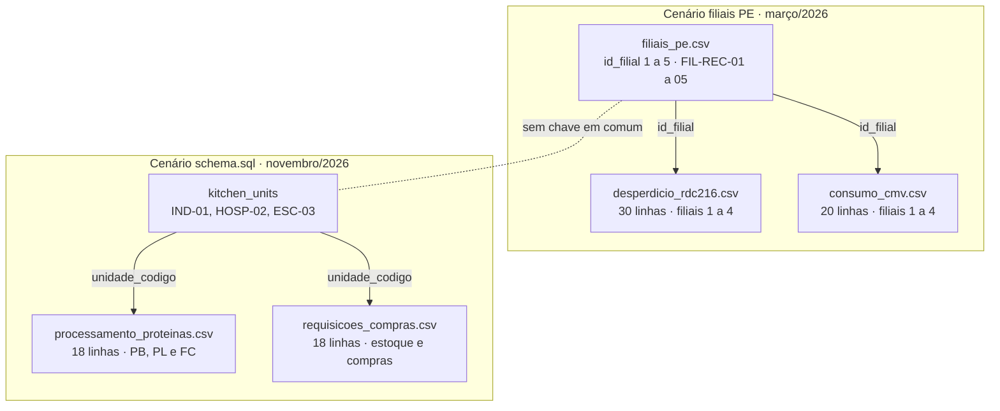

# EvoluiTI · Guia de Localização — Sprint 1 (Trilha de Dados)

> Atualizado em 25/11/2026 · Ponto de partida do Dicionário de Dados da Sprint 1

## Sumário

- [Contexto](#contexto)
- [Mapa do repositório](#mapa-do-repositório)
- [As 13 tabelas do schema.sql v0.3.0](#as-13-tabelas-do-schemasql-v030)
- [Os 5 CSVs, coluna a coluna](#os-5-csvs-coluna-a-coluna)
- [Como os arquivos se conectam](#como-os-arquivos-se-conectam)
- [Pontos de atenção para a limpeza](#pontos-de-atenção-para-a-limpeza)
- [Lacunas e dúvidas para o tech lead](#lacunas-e-dúvidas-para-o-tech-lead)

## Contexto

Estamos na **Sprint 1 — Diagnóstico & Data Quality** da Trilha 3 (Engenharia de Dados & BI) do Projeto Integrador APONTI, cliente-piloto Bondegusto, sistema GastroCore ERP v0.3.0. A entrega da sprint é: auditar as 13 tabelas do `schema.sql` + os CSVs e entregar um **Dicionário de Dados** e um **validador Python** (PB ≥ PL, FC ≥ 1, rupturas e lotes vencidos). Este guia é o ponto de partida desse dicionário.

Missão da trilha: transformar apontamentos do KDS e do Kardex em economia quantificada em R$, via arquitetura Medallion (Bronze → Silver → Gold), Star Schema, Curva ABC e detecção de anomalias Z-Score. Entregas por PR na branch `staging`, isoladas em `analytics/squads/da-<N>/`. Nunca usar dados reais de produção: trabalhar em Postgres Docker local.

| Sprint | Foco | Entrega |
| --- | --- | --- |
| **1 (atual)** | Diagnóstico & Data Quality | Auditoria das 13 tabelas + CSVs, dicionário, validador Python |
| 2 | Medallion & Star Schema | `dim_unidade`, `dim_receita`, `dim_tempo`, fatos de CMV, desperdício, termometria e consumo Kardex |
| 3 | Gold, Curva ABC & Z-Score | Views de CMV/RDC 216, Curva ABC 80/15/5, anomalias Z > +2 SD, previsão sazonal |
| 4 | BI executivo & pitch | Painel (Metabase/Power BI/Streamlit) só sobre `analytics.*` + pitch de economia em R$ e kg |

**Metas UAN (KPIs) que os dados precisam sustentar:**

| KPI | Fórmula | Meta |
| --- | --- | --- |
| CMV % | Custo total de insumos ÷ faturamento bruto × 100 | ≤ 32,0% (atenção 32,1–36%; crítico > 36%) |
| Margem bruta % | (Faturamento − custo) ÷ faturamento × 100 | > 55% verde; 30–55% âmbar; < 30% vermelho |
| Resto-ingesta / PAX | Peso do resto dos pratos (g) ÷ refeições servidas | ≤ 35,0 g por refeição |
| Conformidade térmica | Logs conformes ÷ total de logs × 100 | Quente ≥ 60 °C (Hot Box ≥ 65 °C); fria ≤ 4 °C proteínas / ≤ 5 °C hortifrúti |

Fontes: briefing de sprint e dicionário de dados (PDFs da CESIC Tecnologias) e `docs/gastrocore_schema.json` deste repositório.

## Mapa do repositório

O repositório tem só um `README.md` vazio e a pasta `docs/` com 11 arquivos: 5 CSVs de dados, 3 especificações do banco e 3 de infraestrutura. Ainda não existe `analytics/squads/`.

| Arquivo | Tipo | Para que serve | Uso na trilha de dados |
| --- | --- | --- | --- |
| `gastrocore_filiais_pe.csv` | Dados (5 linhas) | Cadastro das 5 filiais em PE | Base da `dim_unidade` (camada Bronze) |
| `gastrocore_desperdicio_rdc216.csv` | Dados (30 linhas) | Pesagens de sobra, resto-ingesta e aparas, 01–04/03/2026 | `fato_desperdicio`, KPI resto-ingesta, Pareto, Z-Score |
| `gastrocore_consumo_cmv.csv` | Dados (20 linhas) | Consumo previsto × real de insumos e desvio de CMV, 01–04/03/2026 | Fato de CMV, Curva ABC, fator de correção |
| `gastrocore_processamento_proteinas.csv` | Dados (18 linhas) | Rendimento de proteínas: bruto → descongelado → limpo, 02–14/11/2026 | Validação PB ≥ PL e FC ≥ 1 (Sprint 1) |
| `gastrocore_requisicoes_compras.csv` | Dados (18 linhas) | Requisições, transferências e solicitações de compra, 02–13/11/2026 | Rupturas de estoque, consumo Kardex |
| `schema.sql` | DDL PostgreSQL 16 | Cria as 13 tabelas do ERP, políticas RLS e um seed de demonstração | Fonte Bronze; carregado no Postgres pelo Docker |
| `gastrocore_schema.json` | Especificação | Resume as 13 tabelas, 3 dos 5 CSVs e as fórmulas dos KPIs | Referência rápida de colunas e metas |
| `openapi.yaml` | Contrato de API | Endpoints PostgREST (Supabase) de cada tabela | Só se formos extrair dados via API |
| `docker-compose.yml` | Infra | Sobe Postgres 16 (porta 5432) já rodando o `schema.sql` + o front-end | Ambiente local da trilha de dados |
| `Dockerfile` | Infra | Build do front-end React/Vite em Nginx | Não usamos (trilha DevOps) |
| `github-actions-ci-cd.yml` | Infra | Pipeline CI/CD do app (lint, Trivy, GHCR, deploy) | Não usamos (trilha DevOps) |

Para subir o banco local só com o Postgres: colocar `docker-compose.yml` e `schema.sql` na mesma pasta e rodar:

```bash
docker compose up -d postgres
# usuário: gastro_user · banco: gastrocore_hml · porta: 5432
```

O serviço do app precisa do código-fonte do front-end, que não está neste repositório.

## As 13 tabelas do schema.sql v0.3.0

Das 13 tabelas, só 3 vêm com dados no seed (`kitchen_units`, `tenant_configs`, `app_users`); as outras 10 sobem vazias. Todas as PKs são `TEXT`; datas operacionais como `date_str`, `timestamp` e `expiration_date` também estão em `TEXT`, não em tipo data.

| Tabela | Chaves | Colunas e domínios críticos | Uso analítico (Medallion) | Seed |
| --- | --- | --- | --- | --- |
| `kitchen_units` | PK `id` | `name`, `code`, `type` (industrial, hospitalar, escolar), `average_pax_per_day`, `contract_price_per_pax`, `status` (ativa, manutencao, inativa) | Origina `dim_unidade` (receita potencial e metas PAX) | 3 linhas: IND-01, HOSP-02, ESC-03 |
| `ingredients` | PK `id`, FK `unit_id` | `item_type`, `unit` (kg, g, l, L, ml, un, cx, pct, rolo), `current_stock`, `min_stock`, `unit_cost`, `expiration_date`, `status` (normal, baixo, vencendo, vencido), `batches` (JSONB) | Rupturas, lotes vencidos e Curva ABC de insumos | vazia |
| `technical_sheets` | PK `id` | `category`, `yield_portions`, `portion_size_grams`, `cooking_factor`, `ingredients` (JSONB), `cost_per_portion`, `margin_percent` | Origina `dim_receita`; FC = PB ÷ PL | vazia |
| `daily_menu_plans` | PK `id`, FK `unit_id` | `date_str`, `day_of_week`, `shift`, `planned_pax`, `price_per_pax_contracted`, arrays `principais_ids` a `dietas_ids` | Origina `fato_cardapio` e a view de CMV planejado × realizado | vazia |
| `waste_records` | PK `id` (`unit_id` sem FK) | `timestamp`, `period`, `category` (pre_preparo, sobra_limpa, resto_ingesto), `weight_kg`, `estimated_cost_per_kg`, `total_loss_brl` | Alimenta `fato_desperdicio`, Pareto e Z-Score | vazia |
| `hot_box_deliveries` | PK `id`, FK `unit_id` | `dispatch_temp_celsius`, `arrival_temp_celsius`, `status` (em_preparo, em_transito, entregue, nao_conforme), `seal_number`, `pax_count` | Conformidade térmica das rotas transportadas | vazia |
| `proposal_quotes` | PK `id`, FK `unit_id` | `event_type`, `pax`, custos (`raw_food_cost` a `logistics_cost`), `target_margin_percent`, `total_proposal_value`, `status` | Análise comercial e margem por tipo de evento | vazia |
| `tenant_configs` | PK `id` | `company_name`, `trading_name`, `cnpj`, `active_plan`, `enabled_modules` (JSONB) | Metadados do white-label (Bondegusto) | 1 linha |
| `app_users` | PK `id`, FK `unit_id` | `email`, `full_name`, `role` (7 papéis), `pin`; `password_hash` nunca vai para o BI | Auditoria por operador responsável pelos lançamentos | 7 linhas |
| `temperature_logs` | PK `id`, FK `unit_id` | `equipment`, `equipment_type` (quente, frio), `temperature`, `is_compliant`, `time_str`, `shift` | Alimenta `fato_termometria` e a view de conformidade térmica | vazia |
| `stock_movements` | PK `id` (`ingredient_id` sem FK) | `lot_number`, `type` (entrada, saida, perda, ajuste), `quantity`, `total_cost`, `previous_stock`, `new_stock`, `user_name` | Kardex: consumo real diário e Curva ABC | vazia |
| `kds_dish_status` | PK `id`, FK `unit_id` | `date_str`, `shift`, `recipe_id`, `status` (a_iniciar, preparando, pronto), `started_at`, `completed_at` | Lead time de preparo (`completed_at` − `started_at`) | vazia |
| `system_heartbeat` | PK `id` | `environment`, `last_ping_at`, `source` | Disponibilidade do banco (keep-alive) | vazia |

> A coluna "Uso analítico" do PDF do dicionário saiu cortada na impressão; os textos acima foram completados pelo sentido e valem confirmar no HTML original.

## Os 5 CSVs, coluna a coluna

Todos os CSVs têm separador vírgula, decimal com ponto, datas ISO (`AAAA-MM-DD`), nenhum valor nulo e nenhuma linha duplicada. Os cálculos internos batem (CMV, desvios, perdas, FC e pendências conferidos linha a linha), então a limpeza é sobretudo de padronização, não de correção de números.

### `gastrocore_filiais_pe.csv` — dimensão de filiais (5 × 11)

| Coluna | Tipo | Significado |
| --- | --- | --- |
| `id_filial` | inteiro | Chave da filial (1–5), usada pelos CSVs de desperdício e CMV |
| `codigo_unidade` | texto | Código FIL-XXX-NN (ex.: FIL-REC-01) |
| `nome_unidade` | texto | Nome da filial, com acentos |
| `regiao`, `cidade`, `uf` | texto | Localização (todas em PE) |
| `tipo_operacao` | texto | Modelo: cozinha central, satélite, produção local, refeitório |
| `capacidade_refeicoes_dia` | inteiro | Capacidade máxima de refeições por dia |
| `meta_cmv_percentual` | decimal | Meta de CMV da filial (32,5% a 35,0%) |
| `responsavel_tecnica` | texto | Nutricionista RT + CRN, juntos no mesmo campo |
| `status_operacional` | texto | Todas "Ativa" |

### `gastrocore_desperdicio_rdc216.csv` — fato de desperdício (30 × 13)

| Coluna | Tipo | Significado |
| --- | --- | --- |
| `id_registro` | inteiro | Chave do registro |
| `data_registro` | data | 01 a 04/03/2026 |
| `id_filial`, `nome_filial` | inteiro, texto | Filial (só 1 a 4 aparecem) |
| `turno` | texto | Almoco, Jantar, Ceia |
| `tipo_descarte` | texto | Sobra Limpa (15), Resto Ingesta (13), Perda em Pré-Preparo / aparas (2) |
| `peso_kg` | decimal | Peso descartado |
| `custo_estimado_reais` | decimal | Peso × R$/kg fixo: 13,50–14,00 (sobra), 5,50 (aparas), 0,00 (resto) |
| `refeicoes_produzidas_pax` | inteiro | Refeições do turno (repete para todos os registros do mesmo turno) |
| `resto_ingesta_por_pax_gramas` | decimal | Peso × 1000 ÷ PAX; preenchido só no resto-ingesta, 0,0 nos demais |
| `temp_afericao_celsius` | decimal | Temperatura da sobra; 0,0 no resto-ingesta (não aferido) |
| `status_sanitario` | texto | Conforme RDC 216, Risco Térmico (<60C), Descarte Obrigatório, Apara Orgânica |
| `motivo_declarado` | texto livre | Justificativa do operador |

### `gastrocore_consumo_cmv.csv` — fato de consumo e CMV (20 × 17)

| Coluna | Tipo | Significado |
| --- | --- | --- |
| `id_consumo` | inteiro | Chave do registro |
| `data_competencia` | data | 01 a 04/03/2026 |
| `id_filial`, `nome_filial` | inteiro, texto | Filial (só 1 a 4) |
| `categoria_insumo`, `nome_insumo` | texto | Ex.: Proteína Bovina / Acém Bovino em Cubos |
| `qtd_prevista_kg`, `qtd_real_kg` | decimal | Consumo pela ficha técnica × consumo real |
| `custo_unitario_kg` | decimal | R$/kg |
| `cmv_orcado_reais` | decimal | Prevista × custo |
| `cmv_realizado_reais` | decimal | Real × custo |
| `desvio_cmv_reais`, `desvio_cmv_percentual` | decimal | Realizado − orçado; desvio ÷ orçado × 100 |
| `classificacao_abc` | texto | Curva A (12), B (5), C (3) |
| `fator_correcao_teorico`, `fator_correcao_real` | decimal | FC da ficha e FC observado (FC real ≈ FC teórico × real ÷ prevista) |
| `motivo_desvio` | texto livre | Justificativa do desvio |

### `gastrocore_processamento_proteinas.csv` — rendimento de proteínas (18 × 15)

| Coluna | Tipo | Significado |
| --- | --- | --- |
| `data_processamento` | data | 02 a 14/11/2026 |
| `unidade_codigo` | texto | IND-01, HOSP-02, ESC-03 (unidades do `schema.sql`, não as filiais PE) |
| `turno` | texto | almoco, jantar, ceia |
| `tipo_proteina`, `nome_proteina` | texto | AVES, BOVINA, SUINA, PESCADOS, EMBUTIDOS, MIUDOS |
| `peso_bruto_kg` | decimal | PB: peso de compra |
| `peso_pos_descong_kg` | decimal | Peso após descongelar (perda de exsudato) |
| `apara_kg`, `rejeito_kg` | decimal | Perdas na limpeza |
| `peso_limpo_kg` | decimal | PL = pós-descongelamento − apara − rejeito |
| `perda_total_kg`, `perda_pct` | decimal | PB − PL; perda ÷ PB × 100 |
| `fator_correcao_real` | decimal | FC = PB ÷ PL |
| `limite_perda_pct` | decimal | Teto de perda aceito para a proteína |
| `status_perda` | texto | DENTRO_DA_META, ACIMA_DO_LIMITE, CRITICO_DESCONGELAMENTO |

### `gastrocore_requisicoes_compras.csv` — movimentação e compras (18 × 13)

| Coluna | Tipo | Significado |
| --- | --- | --- |
| `tipo_movimento` | texto | requisicao_estoque (8), solicitacao_compra (7), transferencia_unidade (3) |
| `data_solicitacao` | data | 02 a 13/11/2026 |
| `unidade_codigo` | texto | IND-01, HOSP-02, ESC-03 |
| `turno` | texto | almoco, ceia, geral (geral = compras) |
| `categoria_item`, `nome_item` | texto | SECOS ou PROTEINAS |
| `unidade_medida` | texto | KG, UNI, UND, GL |
| `saldo_estoque` | decimal | Saldo no momento da solicitação |
| `qtd_solicitada`, `qtd_entregue`, `qtd_pendente` | decimal | Pendente = solicitada − entregue |
| `valor_unit_estimado`, `valor_total_estimado` | decimal | Total = solicitada × unitário (não o entregue) |

## Como os arquivos se conectam

Os CSVs formam **dois cenários sem chave em comum**: filiais PE (março/2026) e unidades do `schema.sql` (novembro/2026).



Desperdício e CMV juntam com a dimensão de filiais por `id_filial`; proteínas e requisições usam os códigos de `kitchen_units`. Os dois grupos têm períodos e códigos diferentes, então não dá para cruzá-los sem um de-para (pergunta 2 abaixo). A filial 5 (Vitória) não aparece em nenhum fato, e as demais tabelas do `schema.sql` ligam por `unit_id`, mas estão vazias.

Junte sempre pela chave numérica, nunca pelo nome: `nome_filial` vem sem acento nos fatos ("Satelite") e com acento na dimensão ("Satélite").

## Pontos de atenção para a limpeza

A limpeza será de padronização (nomes, categorias, unidades, zeros que significam "sem dado"), não de correção de cálculos. Checklist para a próxima etapa, na ordem sugerida:

**Em todos os CSVs**

- [ ] Converter colunas de data de texto para tipo data
- [ ] Padronizar `turno` em um domínio único (ex.: `almoco`, `jantar`, `ceia`, `geral`): hoje há "Almoco" e "almoco"
- [ ] Padronizar categorias em `snake_case` sem acento (ex.: `sobra_limpa`, `acima_do_limite`), alinhado aos domínios do `schema.sql`
- [ ] Normalizar acentuação: a maior parte do texto está sem acento, mas há exceções ("Tubérculos", "rediluição", "Satélite" só na dimensão)

**Desperdício**

- [ ] Trocar `temp_afericao_celsius` = 0,0 por nulo no resto-ingesta (13 linhas): 0,0 °C é "não aferido", e o dicionário já pede esse filtro na Silver
- [ ] Trocar `resto_ingesta_por_pax_gramas` = 0,0 por nulo fora do resto-ingesta (17 linhas)
- [ ] Marcar `custo_estimado_reais` = 0,00 do resto-ingesta como "não custeado", para não subestimar a perda em R$
- [ ] Mapear `tipo_descarte` para `pre_preparo`, `sobra_limpa`, `resto_ingesto` (domínio de `waste_records`)
- [ ] Remover `nome_filial` (redundante e sem acento) e usar só `id_filial` para juntar com a dimensão

**Consumo / CMV**

- [ ] Revisar `categoria_insumo` "Proteina Caprina/Bovina" (Carne de Sol, que é bovina) e unificar as categorias de proteína
- [ ] Arredondamento: `desvio_cmv_percentual` difere em até 0,005 p.p. do recálculo; decidir se recalculamos na Silver
- [ ] Remover `nome_filial` e juntar por `id_filial`

**Processamento de proteínas**

- [ ] Validar PB ≥ PL e FC ≥ 1 (todas as 18 linhas passam hoje; o validador deve ficar no código para os próximos lotes)
- [ ] Documentar a regra de `CRITICO_DESCONGELAMENTO` (1 linha, perda 35% × limite 25%): não está no dicionário
- [ ] Regra de borda: perda igual ao limite (Charque e Bacon) está como `DENTRO_DA_META`, ou seja, a regra é "perda ≤ limite"

**Requisições e compras**

- [ ] Unificar `unidade_medida`: `UNI` e `UND` são a mesma unidade; mapear para o domínio do `schema.sql` (`kg`, `un`, `l`...); `GL` (galão) precisa de volume definido
- [ ] Separar embalagem do nome do item ("Acucar Cristal 1kg" medido em KG; "Cafe Tradicional 250g" em UNI)
- [ ] Criar `valor_entregue` (entregue × unitário), já que `valor_total_estimado` usa a quantidade solicitada
- [ ] Tratar `turno` = "geral" das compras (não é turno de produção)

**Governança (não é CSV, mas aparece na auditoria)**

- [ ] O seed de `app_users` grava senhas em texto puro no campo `password_hash`, e as políticas RLS liberam leitura e escrita para `anon`. Não levar `password_hash` nem `pin` para nenhuma camada analítica e registrar isso no relatório de auditoria.

## Lacunas e dúvidas para o tech lead

Cinco perguntas que mudam como modelamos a Silver; vale levar ao tech lead antes da Sprint 2.

1. **Faturamento para o CMV %:** nenhum CSV traz faturamento por filial PE. Usamos capacidade × preço por PAX, refeições produzidas × preço, ou virá outro dataset? (Preço por PAX só existe para IND-01, HOSP-02 e ESC-03.)
2. **De-para de unidades:** como relacionar as filiais FIL-REC-01…FIL-VIT-05 com IND-01, HOSP-02 e ESC-03? Ou são dois cenários independentes?
3. **Datasets não documentados:** `processamento_proteinas` e `requisicoes_compras` estão no briefing, mas não no dicionário nem no `gastrocore_schema.json`. Entram na Bronze junto com os outros três?
4. **Tabelas vazias:** 10 das 13 tabelas sobem sem dados. A auditoria de rupturas e lotes vencidos (`ingredients`) deve ser feita sobre dados sintéticos que nós geramos?
5. **Número do squad:** qual o nosso `da-<N>` para criar `analytics/squads/da-<N>/` e abrir PR na `staging`?
